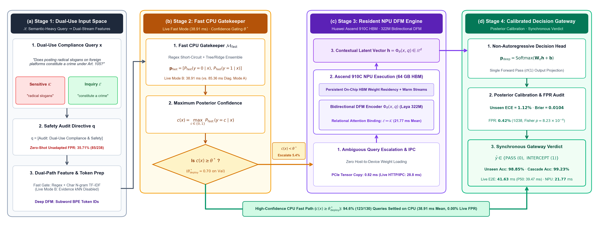
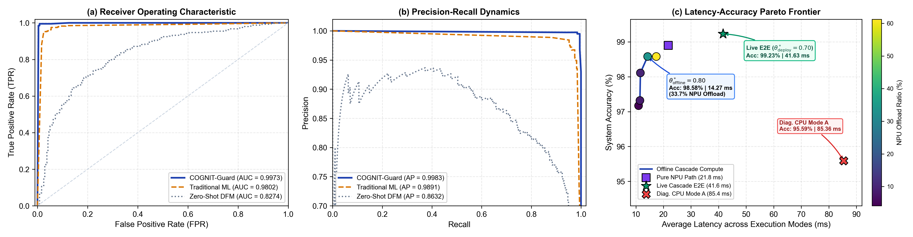

# COGNIT-Guard: Calibrated Standalone Direct-Decision Guardrails with Heterogeneous CPU-NPU Confidence Cascading under Explicit Latency and False-Positive Constraints

[](https://arxiv.org/abs/2609.33671)
[](LICENSE)
[-red)]()
[]()
[]()

Official PyTorch / Ascend NPU implementation for **[COGNIT-Guard: Calibrated Standalone Direct-Decision Guardrails with Heterogeneous CPU-NPU Confidence Cascading under Explicit Latency and False-Positive Constraints](https://arxiv.org/abs/2609.33671)** (`arXiv:2609.33671`).

<p align="center">
  
</p>

---

## 🔍 Overview

Real-time LLM safety guardrails suffer from a fundamental tension between **dual-use over-defensiveness** (falsely blocking benign legal, medical, and regulatory compliance queries that share surface vocabulary with harmful prompts) and **strict latency SLOs** ($< 50$ ms).

**COGNIT-Guard** resolves this tension via a calibrated two-stage confidence-gated cascade:
1. **Stage-1 Fast CPU Gatekeeper (`ml_system/`)**: A lightweight `TF-IDF + XGBoost` gatekeeper operating in fast inline mode (`Mode B`, **38.91 ms** mean latency), settling high-confidence traffic directly on CPU;
2. **Stage-2 Calibrated Direct Decision Engine (`ascend_910c_laya/`)**: A 322M Decision Foundation Model (`convaiinnovations/laya`) fine-tuned under proper scoring rules and pinned in Huawei Ascend 910C on-chip HBM (**21.77 ms** warm NPU inference, **45.90 QPS**), invoked only when Stage-1 confidence falls below the validation-calibrated threshold $\theta^*_{\text{deploy}} = 0.70$;
3. **Experience Replay Rehearsal**: Mitigates the domain alignment tax on out-of-distribution general safety benchmarks (`SafetyBench-ZH`).

---

## 📊 Key Empirical Results

### 1. Mitigating Dual-Use Over-Defensiveness on Unseen Data ($N=607$, Zero Overlap)

| Guardrail Model / Paradigm | Accuracy (%) $\uparrow$ | False Positive Rate (FPR %) $\downarrow$ | FNR (%) $\downarrow$ | ECE (%) $\downarrow$ | Brier Score $\downarrow$ | Mean Latency (ms) |
| :--- | :---: | :---: | :---: | :---: | :---: | :---: |
| **Zero-Shot 322M DFM** (`laya`) | 76.61 | 35.71 | 15.45 | 5.38 | 0.1654 | 22.88 (NPU) |
| **Zero-Shot 8B Contrastive DFM** (`CLM-8B`) | 64.25 | 90.34 | 0.54 | 24.29 | 0.2762 | 45.78 (1-Stream NPU) |
| **Traditional ML** (`TF-IDF + XGBoost`) | 95.39 | 5.88 | 3.79 | 13.11 | 0.0525 | 38.91 (Fast CPU) |
| **Domain-FT 8B Contrastive DFM** (`CLM-8B`) | **98.85** | **1.68** (0.00 @ Zero-FPR) | **0.81** | **0.83** | **0.0091** | 45.78 (6.64 Batch / 0.60 Hit) |
| **COGNIT-Guard Stage-2 DFM (322M, Ours)** | **98.85** | **0.42** | **1.63** | **1.12** | **0.0104** | **21.77 (Warm NPU)** |
| **COGNIT-Guard Live Serial Cascade ($\theta^*=0.70$)** | **99.23** | **0.00** | **1.22** | **1.08** | **0.0098** | **41.63 (94.6% CPU)** |

<p align="center">
  
</p>

### 2. Stage-by-Stage Latency & Hardware Residency Breakdown

- **CPU Mode A (Diagnostic Mode, `include_evidence=True`)**: **85.36 ms** mean (56.06 ms parsing/scoring + 29.30 ms 3rd-corpus kNN evidence retrieval).
- **CPU Mode B (Live Fast Gatekeeper, `include_evidence=False`)**: **38.91 ms** mean (P50: 38.12 ms, P95: 54.80 ms).
- **Ascend 910C Warm HBM Residency (`322M laya`)**: Pinning weights and pre-allocated buffers in 64 GB on-chip HBM reduces NPU latency from 48.20 ms (cold-start) to **21.77 ms** ($2.21\times$ speedup).
- **Disaggregated Contrastive Scaling (`CLM-8B`)**: Adapting only the 73 MB dual-tower SwiGLU projection heads ($2.81\text{ s}$ Zero-FPR / $3.73\text{ s}$ Best-Acc) over a frozen `Qwen3-8B` encoder achieves **98.85%** accuracy (**0.83%** ECE, **0.0091** Brier) at **45.78 ms** uncached 1-stream latency, **6.64 ms/query** batched ($B=64$), and **0.60 ms** on HBM `VectorArena` cache hits.
- **Live End-to-End Serial Cascade ($\theta^*_{\text{deploy}}=0.70$, Held-Out Slice $N=130$)**: Settles **94.62% (123/130)** of queries on Fast CPU and escalates **5.38% (7/130)** to NPU, achieving $\mathbb{E}[T_{\text{server}}] = \mathbf{41.63\text{ ms}}$ (P50: 39.47 ms, P95: 76.25 ms), **99.23% accuracy**, and **0.00% FPR**.

### 3. OOD Generalization & Alignment Tax Mitigation (`SafetyBench-ZH`, $N=2,100$)

- Incorporating a **15.56% disjoint experience replay mix ($N_{\text{replay}}=458$)** recovers OOD accuracy on `SafetyBench-ZH` from 56.81% (pure domain fine-tuning) to **65.05%** ($+4.72\%$ above the zero-shot base model) while simultaneously lifting in-domain accuracy to **99.67%** (605/607). For `CLM-8B`, rehearsal lifts `Clean-607` accuracy to **99.84%** (**0.00% FPR**, **0.86% ECE**) while recovering `SafetyBench-ZH` OOD accuracy from 55.10% to **64.10%**.

---

## 📂 Repository Structure

```text
cascaded-guardrail-npu/
├── ml_system/                        # Stage-1 Fast CPU Gatekeeper (Mode A diagnostic & Mode B inline)
│   ├── ai_security_audit/            # Core hybrid lexical + TF-IDF + XGBoost classifier
│   ├── audit_system.py               # Gatekeeper service wrapper
│   ├── main.py                       # CLI inference entrypoint
│   └── benchmark_results/            # Reference Stage-1 evaluation summaries
├── ascend_910c_laya/                 # Stage-2 Huawei Ascend 910C NPU Direct Decision Engine
│   ├── scripts/                      # NPU fine-tuning & HBM residency benchmarking scripts
│   └── results/                      # Reference Stage-2 & rehearsal evaluation summaries
├── dataset/                          # SHA-256 leak-free deduplication utility & split metadata
│   ├── split_clean_dataset.py
│   ├── split_specification.json
│   └── clean_splits/
├── evaluate_clean_vs_raw.py          # Leak-free unseen test split evaluator
├── benchmark_true_cascade.py         # End-to-end live serial CPU-to-NPU cascade profiler
├── benchmark_safetybench_ml.py       # SafetyBench-ZH OOD generalization evaluator
├── finetune_and_eval_rehearsal.py    # Experience replay rehearsal training & evaluation
├── run_3way_comparison.py            # Zero-Shot vs. ML vs. COGNIT-Guard comparison runner
├── run_ablation_experiments.py       # Threshold sweep & hardware residency ablation suite
├── assets/                           # Framework & evaluation figures
├── REPRODUCIBILITY.md                # Environment specifications & benchmark reproduction guide
├── pyproject.toml & uv.lock          # Deterministic dependency management via uv
└── LICENSE                           # Apache-2.0 License
```

---

## ⚙️ Installation & Environment

Dependencies are managed deterministically via [`uv`](https://docs.astral.sh/uv/):

```bash
# CPU Gatekeeper & evaluation environment
uv sync --extra cpu

# Huawei Ascend 910C NPU container environment (CANN 9.1.0 + torch_npu)
uv venv --system-site-packages .venv
source .venv/bin/activate
uv sync --no-install-project
```

---

## 🚀 Quickstart

### 1. Stage-1 CPU Gatekeeper & Leak-Free Evaluation

```bash
uv run python ml_system/main.py "请审核这段合规法条咨询文本是否需要拦截"
uv run python evaluate_clean_vs_raw.py
uv run python benchmark_safetybench_ml.py
```

### 2. Stage-2 Ascend 910C NPU & Live Serial Cascade Evaluation

```bash
uv run --no-sync python ascend_910c_laya/scripts/benchmark_finetuned.py
uv run --no-sync python benchmark_true_cascade.py
uv run --no-sync python finetune_and_eval_rehearsal.py
uv run --no-sync python run_ablation_experiments.py
```

See [`REPRODUCIBILITY.md`](REPRODUCIBILITY.md) for detailed hardware residency configurations and benchmark mappings.

---

## 📝 Citation

If you find this work or code useful in your research, please consider citing:

```bibtex
@article{chen2026cognitguard,
  title         = {COGNIT-Guard: Calibrated Standalone Direct-Decision Guardrails with Heterogeneous CPU-NPU Confidence Cascading under Explicit Latency and False-Positive Constraints},
  author        = {Chen, Hao},
  journal       = {arXiv preprint arXiv:2609.33671},
  year          = {2026},
  eprint        = {2609.33671},
  archivePrefix = {arXiv},
  primaryClass  = {cs.CR},
  url           = {https://arxiv.org/abs/2609.33671}
}
```

## 🙏 Acknowledgments

We thank the laboratory at the **Shenzhen Research Institute of Big Data (SRIBD)** for providing Huawei Ascend 910C NPU computing resources.
